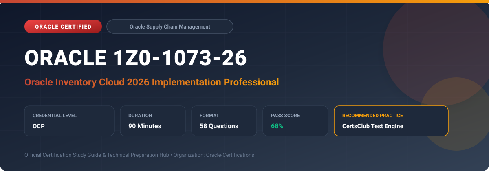

  

# Oracle 1Z0-1073-26: Oracle Inventory Cloud 2026 Implementation Professional

---

## 1. Exam Overview & Candidate Profile

The **Oracle 1Z0-1073-26: Oracle Inventory Cloud 2026 Implementation Professional** examination is designed for supply chain professionals, cloud solution architects, ERP implementation consultants, and inventory specialists seeking to validate practical mastery of Oracle Inventory Management Cloud.

Earning this credential demonstrates your capability to set up enterprise inventory structures, manage stock locator hierarchies, configure lot and serial controls, implement replenishment strategies (including Min-Max and Kanban), orchestrate inter-organization and intra-organization transfers, execute physical counting and cycle counts, and manage consigned and customer-owned inventory.

### Target Audience & Prerequisites
- **Target Roles**: SCM Cloud Functional Consultants, Enterprise Inventory Managers, Supply Chain Solution Architects, and ERP Implementation Specialists.
- **Recommended Experience**: 1–2 years of practical experience implementing or administering Oracle SCM Cloud solutions.
- **Credential Earned**: Oracle Certified Professional (OCP).

---

## 2. Key Exam Specifications

| Specification | Details |
| :--- | :--- |
| **Exam Code** | **Oracle 1Z0-1073-26** |
| **Official Title** | Oracle Inventory Cloud 2026 Implementation Professional |
| **Certification Track** | Oracle Supply Chain Management Cloud |
| **Exam Duration** | 90 Minutes |
| **Number of Questions** | 58 Questions |
| **Passing Score** | 68% |
| **Question Format** | Multiple Choice (Single/Multiple Answer), Scenario-Based Questions |
| **Delivery Provider** | Oracle University / Pearson VUE (Online Proctored or Test Center) |
| **Recommended Practice Engine** | [CertsClub Oracle Practice Tests](https://www.certsclub.com/oracle/1z0-1073-26-dumps.html) |

---

## 3. Official Blueprint & Exam Domain Breakdown

The examination assesses candidate competencies across core functional domains weighted as follows:

| Domain Area | Weighting |
| :--- | :--- |
| **Enterprise Inventory Structures & Organization Setup** | `20%` |
| **Inventory Transactions, Transfers & Movement Requests** | `25%` |
| **Lot, Serial, & Item Attribute Controls** | `15%` |
| **Replenishment Planning (Min-Max, Kanban, Reorder Points)** | `15%` |
| **Physical Inventory, Cycle Counting, & Accuracy Auditing** | `15%` |
| **Consigned Inventory & External Ownership Integration** | `10%` |

---

## 4. Deep Dive into Complex & Challenging Technical Topics

To secure a passing score on the 1Z0-1073-26 exam, candidates must master the following advanced concepts:

- **Subinventory and Locator Hierarchy Design**: Implementing dynamic locator assignment rules, capacity constraints, and subinventory parameters for restricted vs. unrestricted inventory access.
- **Inter-Organization Transfer Orchestration**: Configuring shipping networks, direct transfers vs. in-transit transfers with internal requisition/internal sales order (IR-ISO) workflows.
- **Advanced Lot and Serial Number Lifecycle**: Managing parent-child lots, lot grade controls, genealogy tracking, and point-of-receipt serial generation versus pre-defined serial allocation.
- **Automated Replenishment**: Tuning Min-Max parameters at both subinventory and organization levels, incorporating lead times, safety stocks, and lot multipliers into automated movement request generation.
- **Consigned Inventory Accounting & Invoicing**: Managing consigned stock agreements, consumption advice generation, ownership transfer points, and automated financial settlements.

---

## 5. Scenario-Based Demo & Practice Questions

### Question 1
An enterprise needs to move stock from a central distribution center to a regional branch inventory organization. The transit duration is three days, and accounting requires the inventory value to remain visible on the balance sheet as in-transit inventory during shipment. How should the shipping network be configured?

A) Direct Transfer with FOB Point set to Destination  
B) In-Transit Transfer with FOB Point set to Shipping  
C) Movement Request Transfer with Subinventory staging  
D) Standard PO Receipt with Drop Shipment  

- **Correct Answer**: `B) In-Transit Transfer with FOB Point set to Shipping`  
- **Technical Explanation**: An In-Transit transfer type records inventory in an in-transit valuation account during transit. Setting the Free On Board (FOB) point to Shipping transfers ownership and financial responsibility to the receiving organization upon departure from the shipping organization.

---

### Question 2
A warehouse manager wants to execute cycle counts where items with high annual dollar volume are counted every month, while low-turnover items are counted once a year. Which Oracle Inventory Cloud mechanism must be implemented?

A) Physical Inventory Tag Generation  
B) ABC Classification with Cycle Count Frequency Rules  
C) Min-Max Replenishment Parameters  
D) Kanban Allocation Matrix  

- **Correct Answer**: `B) ABC Classification with Cycle Count Frequency Rules`  
- **Technical Explanation**: ABC Analysis classifies items based on criteria such as current inventory value or annual transaction value (Classes A, B, C). Cycle count definitions then assign distinct count frequencies to each ABC class (e.g., Class A counted monthly, Class C annually).

---

## 6. Recommended Preparation Strategy & Practice Testing Engine

Achieving certification in **Oracle 1Z0-1073-26** requires balanced theoretical study and scenario-based simulation practice:

1. **Review Oracle Documentation**: Master architecture guides, implementation workbooks, and administration manuals on the Oracle Help Center.
2. **Hands-on Lab Practice**: Execute real-world configuration, policy setup, and troubleshooting tasks in your cloud tenancy or test instance.
3. **Simulated Exam Drills**: Practice answering timed, scenario-based multiple-choice questions to familiarize yourself with the question formats, traps, and timing constraints.

### Practice With CertsClub
For realistic practice questions, updated dumps, and mock testing environments:
- **Resource**: [CertsClub Oracle Practice Test Engine](https://www.certsclub.com/oracle/1z0-1073-26-dumps.html)
- **Special Discount**: Use coupon code **`club20`** during checkout for an instant **20% discount** on all practice exam bundles and testing engines.

---

## 7. Official Documentation & References

- [Oracle University Certification Registry](https://education.oracle.com/)
- [Oracle Help Center Documentation Portal](https://docs.oracle.com/)
- [Oracle Cloud Infrastructure & Applications Guides](https://docs.oracle.com/en/cloud/)
- [CertsClub Oracle Certification Exam Practice](https://www.certsclub.com/oracle/1z0-1073-26-dumps.html)

---

## 8. SEO & Discovery Keywords

`oracle 1z0-1073-26`, `oracle 1z0-1073-26 exam`, `oracle 1z0-1073-26 dumps`, `1Z0-1073-26 practice questions`, `1Z0-1073-26 study guide`, `oracle 1z0-1073-26 syllabus`, `oracle inventory cloud 2026 implementation professional`, `certsclub 1z0-1073-26`
